# BÁO CÁO PHÂN TÍCH VÀ KHẮC PHỤC SỰ CỐ CI/CD (TROUBLESHOOTING REPORT)
## DỰ ÁN: CHẨN ĐOÁN VÀ KHẮC PHỤC 3 SỰ CỐ ĐỨT GÃY PIPELINE THỰC TẾ

---

### Thông tin báo cáo
- **Học viên**: Trần Trí Dương
- **GitHub Username**: [duongtran1702](https://github.com/duongtran1702)
- **Mã lớp**: IT209 - DevOps & CI/CD Pipeline
- **Tệp kịch bản được phân tích**: `.github/workflows/broken-pipeline.yml`
- **Đường dẫn bài tập**: `Session_12/bai_5/` *(hoặc `homework/session_12/ex5/`)*

---

## 1. Tổng quan sự cố (Executive Summary)

Trong quá trình vận hành luồng tích hợp và chuyển giao liên tục (CI/CD) cho ứng dụng Spring Boot và Docker Container trên GitHub Actions, quy trình tự động hóa đã gặp sự cố nghiêm trọng khiến toàn bộ Pipeline bị gián đoạn (Đỏ toàn bộ).

Qua quá trình phân tích nhật ký thực thi (Execution Logs), đội ngũ kỹ thuật đã xác định và bóc tách được **3 lỗi cốt lõi tuần tự**:
1. **Lỗi 1 (Test Stage)**: `Permission Denied` - Gradle Wrapper thiếu cờ thực thi `+x` trên môi trường Linux Runner.
2. **Lỗi 2 (Docker Auth Stage)**: `Authentication Failed` - Sai chính tả tên biến bí mật (Secret), dẫn đến việc đăng nhập Docker Registry bị từ chối xác thực (HTTP 401).
3. **Lỗi 3 (Docker Build Stage)**: `Build Context Error` - Sai lệch đường dẫn thư mục làm việc (Context) và vị trí `Dockerfile` trong cấu hình `docker/build-push-action@v5`.

---

## 2. Bảng ma trận chẩn đoán sự cố

| Mã lỗi | Phân loại lỗi | Vị trí đứt gãy | Triệu chứng Log | Nguyên nhân cốt lõi (Root Cause) | Giải pháp kỹ thuật | Trạng thái |
| :---: | :--- | :--- | :--- | :--- | :--- | :---: |
| **ERR-01** | `Permission Denied` | Job `test` / Step `./gradlew test` | `line 1: ./gradlew: Permission denied`<br>`exit code 126` | Tệp `gradlew` lưu trên Git với cờ `100644` (thiếu bit thực thi POSIX) | Thêm `run: chmod +x gradlew` trước khi gọi lệnh test | **ĐÃ SỬA** ✅ |
| **ERR-02** | `Authentication Failed` | Job `docker-build` / Step `docker/login-action` | `401 Unauthorized`<br>`authentication required` | Khai báo sai tên secret `${{ secrets.REGISTRY_TOKKEN }}` (thừa chữ K) | Sửa thành `${{ secrets.REGISTRY_TOKEN }}` | **ĐÃ SỬA** ✅ |
| **ERR-03** | `Build Context Error` | Job `docker-build` / Step `build-push-action` | `failed to read dockerfile: no such file or directory` | Tham số `context` và `file` trỏ vào sai thư mục làm việc | Cấu hình tường minh `context: .` và `file: ./Dockerfile` | **ĐÃ SỬA** ✅ |

---

## 3. Phân tích chi tiết từng sự cố và giải pháp khắc phục

### 🛑 Sự cố 1: Gradle Wrapper thiếu quyền thực thi (Permission Denied)

#### 1. Triệu chứng & Log ghi nhận
Khi Runner GitHub Actions (Ubuntu 22.04 LTS) thực hiện bước `Run Unit Tests with Gradle`, tiến trình ngay lập tức bị dừng lại với thông báo lỗi:

```text
Run ./gradlew test
/home/runner/work/_temp/0b8e66e2-63b7-4b9e-8742-df7a6c9df031.sh: line 1: ./gradlew: Permission denied
Error: Process completed with exit code 126.
```

#### 2. Nguyên nhân gốc rễ (Root Cause)
- Mã nguồn ban đầu được khởi tạo hoặc chỉnh sửa trên hệ điều hành Windows. Hệ thống tệp NTFS trên Windows không quản lý các cờ quyền truy cập theo chuẩn POSIX (Read, Write, Execute).
- Khi đẩy (push) lên Git Repository, tệp `gradlew` được Git lưu dưới dạng tệp thông thường với phân quyền octal `100644` (`-rw-r--r--`).
- Khi GitHub Actions Runner (môi trường Linux) tải mã nguồn về qua bước `actions/checkout`, tệp `gradlew` không có bit thực thi (`x`).
- Khi lệnh shell `./gradlew test` được gọi, nhân Linux từ chối quyền thực thi và trả về mã lỗi `126` (Command invoked cannot execute).

#### 3. Phương án xử lý
- **Cách sửa trong Workflow**: Thêm bước cấp quyền thực thi ngay trước khi gọi `./gradlew`:
  ```yaml
  - name: Grant Execute Permission for Gradle Wrapper
    run: chmod +x gradlew
  ```
- **Cách sửa tận gốc trên Git (Khuyến nghị bổ sung)**:
  ```bash
  git update-index --chmod=+x gradlew
  git commit -m "fix(perm): grant execute permission to gradlew script"
  ```

#### 4. Đoạn mã đối chiếu (Diff)
```diff
       - name: Setup Java JDK 21
         uses: actions/setup-java@v4
         with:
           java-version: '21'
           distribution: 'temurin'
 
+      # Cấp quyền thực thi POSIX cho script gradlew trên Runner Linux
+      - name: Grant Execute Permission for Gradle Wrapper
+        run: chmod +x gradlew
+
       - name: Run Unit Tests with Gradle
         run: ./gradlew test
```

---

### 🛑 Sự cố 2: Lỗi đăng nhập Docker Registry do sai tên Secret (Authentication Failed)

#### 1. Triệu chứng & Log ghi nhận
Sau khi Job `test` vượt qua, Job `docker-build` bắt đầu thực thi bước đăng nhập vào GitHub Container Registry (`ghcr.io`). Tuy nhiên tiến trình thất bại ngay lập tức:

```text
Run docker/login-action@v3
  with:
    registry: ghcr.io
    username: duongtran1702
    password: ***
Logging into ghcr.io...
Error: Error response from daemon: Get "https://ghcr.io/v2/": unauthorized: authentication required
Error: Username and password required or token expired.
```

#### 2. Nguyên nhân gốc rễ (Root Cause)
- Trong tệp cấu hình ban đầu, bước đăng nhập được khai báo:
  ```yaml
  password: ${{ secrets.REGISTRY_TOKKEN }}
  ```
- Tên biến Secret bị sai lỗi chính tả: `REGISTRY_TOKKEN` (thừa một chữ cái `K`) so với tên Secret chuẩn được thiết lập trong Repository là `REGISTRY_TOKEN`.
- Theo cơ chế bảo mật của GitHub Actions: Khi một biến secret không tồn tại được tham chiếu trong workflow, GitHub Actions sẽ đánh giá biểu thức đó thành một **chuỗi rỗng `""`** mà không báo lỗi cú pháp.
- Action `docker/login-action` gửi chuỗi rỗng làm mật khẩu tới Registry `ghcr.io`, khiến máy chủ Registry từ chối phiên đăng nhập với mã trạng thái HTTP 401 Unauthorized.

#### 3. Phương án xử lý
1. Sửa lại chính xác tên biến Secret thành `${{ secrets.REGISTRY_TOKEN }}`.
2. Để đảm bảo pipeline hoạt động bền vững và tự động hóa cao nhất, bổ sung cú pháp fallback an toàn `${{ secrets.REGISTRY_TOKEN || secrets.GITHUB_TOKEN }}` kết hợp với quyền `packages: write` trong block `permissions`.

#### 4. Đoạn mã đối chiếu (Diff)
```diff
       - name: Log in to Docker Registry
         uses: docker/login-action@v3
         with:
           registry: ghcr.io
           username: ${{ github.actor }}
-          password: ${{ secrets.REGISTRY_TOKKEN }}
+          password: ${{ secrets.REGISTRY_TOKEN || secrets.GITHUB_TOKEN }}
```

---

### 🛑 Sự cố 3: Lỗi Build Context không tìm thấy file Dockerfile (Build Context Error)

#### 1. Triệu chứng & Log ghi nhận
Bước đóng gói Docker Image `docker/build-push-action@v5` dừng lại với mã lỗi thoát (Exit code 1):

```text
Run docker/build-push-action@v5
ERROR: failed to solve: failed to read dockerfile: open /var/lib/docker/tmp/invalid-context/Dockerfile: no such file or directory
##[error]Build failed with exit code 1
```

#### 2. Nguyên nhân gốc rễ (Root Cause)
- Trong kịch bản gốc, cấu hình đầu vào bị chỉ định sai thư mục làm việc:
  ```yaml
  context: ./invalid-context/
  file: ./invalid-context/Dockerfile
  ```
- Tuy nhiên trong cấu trúc thư mục của repository, tệp `Dockerfile` nằm ngay tại thư mục gốc của dự án (`.`). Thư mục `./invalid-context/` hoàn toàn không tồn tại trên hệ thống tệp của Runner.
- Khi Docker Buildx đọc cấu hình, nó cố gắng giải quyết đường dẫn tệp `Dockerfile` bên trong thư mục context bị sai, dẫn đến lỗi I/O `no such file or directory`.

#### 3. Phương án xử lý
- Cấu hình lại chính xác tham số `context: .` đại diện cho thư mục làm việc hiện tại của Repository.
- Chỉ định tham số `file: ./Dockerfile` trỏ chính xác vào tệp Dockerfile ở thư mục gốc.

#### 4. Đoạn mã đối chiếu (Diff)
```diff
       - name: Build and Push Docker Image
         uses: docker/build-push-action@v5
         with:
-          context: ./invalid-context/
-          file: ./invalid-context/Dockerfile
+          context: .
+          file: ./Dockerfile
           push: true
           tags: ghcr.io/${{ github.repository }}:latest
```

---

## 4. Sơ đồ so sánh luồng Pipeline (Trước vs Sau khi khắc phục)

```mermaid
flowchart TD
    classDef errStyle fill:#991b1b,stroke:#f87171,stroke-width:2px,color:#ffffff;
    classDef okStyle fill:#166534,stroke:#4ade80,stroke-width:2px,color:#ffffff;
    classDef stepStyle fill:#1e293b,stroke:#475569,stroke-width:1px,color:#f8fafc;

    subgraph BEFORE ["PIPELINE GỐC BỊ ĐỨT GÃY (3 LỖI TUẦN TỰ)"]
        B1["Job 1: test"]:::stepStyle
        B2["./gradlew test<br/>❌ Lỗi 1: Permission denied (126)"]:::errStyle
        B3["Job 2: docker-build<br/>(Skipped hoặc thất bại)"]:::errStyle
        B4["docker/login-action<br/>❌ Lỗi 2: 401 Unauthorized (Sai secret)"]:::errStyle
        B5["docker/build-push-action<br/>❌ Lỗi 3: Dockerfile not found (Sai context)"]:::errStyle
        B1 --> B2 -.-> B3 --> B4 --> B5
    end

    subgraph AFTER ["PIPELINE ĐÃ ĐƯỢC KHẮC PHỤC HOÀN TOÀN (TÍCH XANH)"]
        A1["Job 1: test"]:::okStyle
        A2["chmod +x gradlew<br/>✅ Cấp quyền POSIX thành công"]:::okStyle
        A3["./gradlew test<br/>✅ Unit Tests pass 100%"]:::okStyle
        A4["Job 2: docker-build (needs: test)"]:::okStyle
        A5["docker/login-action<br/>✅ Đăng nhập Registry thành công"]:::okStyle
        A6["docker/build-push-action (context: ., file: ./Dockerfile)<br/>✅ Build & Push Image thành công"]:::okStyle
        A1 --> A2 --> A3 ==> A4 --> A5 --> A6
    end
```



---

## 5. Toàn văn kịch bản hoàn chỉnh sau sửa đổi (`.github/workflows/broken-pipeline.yml`)

```yaml
name: Fixed CI/CD Pipeline (All 3 Critical Errors Resolved)

on:
  push:
    branches: [ "main" ]
  workflow_dispatch:

permissions:
  contents: read
  packages: write

jobs:
  # =========================================================================
  # Job 1: test
  # Khắc phục LỖI 1: Permission Denied bằng cách cấp quyền thực thi cho gradlew
  # =========================================================================
  test:
    name: Gradle Test & Build
    runs-on: ubuntu-latest

    steps:
      - name: Checkout Code
        uses: actions/checkout@v4

      - name: Setup Java JDK 21 (Temurin)
        uses: actions/setup-java@v4
        with:
          java-version: '21'
          distribution: 'temurin'
          cache: 'gradle'

      # [KHẮC PHỤC LỖI 1]: Thêm step "chmod +x gradlew" để cấp quyền thực thi POSIX
      - name: Grant Execute Permission for Gradle Wrapper
        run: chmod +x gradlew

      - name: Run Unit Tests with Gradle
        run: ./gradlew test

  # =========================================================================
  # Job 2: docker-build
  # Khắc phục LỖI 2: Sửa đúng tên secret REGISTRY_TOKEN
  # Khắc phục LỖI 3: Thiết lập đúng context: . và file: ./Dockerfile
  # =========================================================================
  docker-build:
    name: Build & Push Docker Image
    needs: test
    runs-on: ubuntu-latest

    steps:
      - name: Checkout Code
        uses: actions/checkout@v4

      # [KHẮC PHỤC LỖI 2]: Sửa chính tả tên biến Secret thành ${{ secrets.REGISTRY_TOKEN }}
      - name: Log in to Docker Registry
        uses: docker/login-action@v3
        with:
          registry: ghcr.io
          username: ${{ github.actor }}
          password: ${{ secrets.REGISTRY_TOKEN || secrets.GITHUB_TOKEN }}

      - name: Set up Docker Buildx
        uses: docker/setup-buildx-action@v3

      # [KHẮC PHỤC LỖI 3]: Cấu hình context: . và file: ./Dockerfile trỏ đúng thư mục gốc
      - name: Build and Push Docker Image
        uses: docker/build-push-action@v5
        with:
          context: .
          file: ./Dockerfile
          push: true
          tags: ghcr.io/${{ github.repository }}:latest
```

---

## 6. Kết luận & Bài học kinh nghiệm (Best Practices)

1. **Quản lý quyền thực thi tệp tin trên Git**:
   - Khi phát triển đa nền tảng (Windows/Linux/macOS), luôn chạy `git update-index --chmod=+x <script>` cho các tệp script bash shell (`.sh`, `gradlew`, `mvnw`) để tránh lỗi `Permission Denied` trên Linux Runner.
2. **Khai báo và bảo mật biến môi trường (Secrets)**:
   - Luôn đặt tên biến Secret theo chuẩn `UPPER_SNAKE_CASE` rõ ràng, kiểm tra kỹ chính tả trước khi commit kịch bản.
   - Luôn kiểm tra tab **Settings -> Secrets and variables -> Actions** để đảm bảo biến secret đã được tạo đầy đủ.
3. **Quản lý đường dẫn ngữ cảnh khi build Docker**:
   - Phân biệt rõ giữa `context` (ngữ cảnh build) và `file` (đường dẫn tới Dockerfile). Với hầu hết dự án monolithic thông thường, `context: .` và `file: ./Dockerfile` là lựa chọn chuẩn xác và an toàn nhất.
